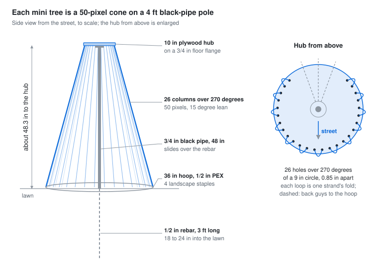

# Mini trees

Two mini trees use last year's pixels: 27 strands of 100 [Wally's Lights 12 V WS2811 xConnect
bullet pixels](https://wallyslights.com/products/12v-ws2811-xconnect-resistor-bullet-pixel?variant=39808961413278),
mounted in strips at 1 inch spacing with 4 inches of wire between shells. Each tree takes 13
strands; the 27th is a spare.

Each tree is a cone about 48 inches tall: a 4 ft black-pipe pole, a 10 inch plywood hub on top
and a 36 inch PEX hoop at the bottom. Each strand folds over the hub, so it makes two of the 26
columns (50 pixels up, 50 down) and both of its ends land at the bottom, next to the controller.

| Part | Size | Why |
| --- | --- | --- |
| Columns | 26, 13.85 degrees apart, 50 pixels each at 1 inch | 13 strands of 100, folded at the top |
| Hub | 10 inch plywood disk, 26 holes on a 9 inch circle | columns sit 1.21 inches apart at the top, well inside the 4 inches of wire between pixels 50 and 51 |
| Base hoop | 36 inch circle of 1/2 inch PEX, about 9.5 ft | base about 0.74 x height, the same cone shape as the MegaTree; columns 4.35 inches apart at the bottom |
| Height to hub | about 48.3 inches | 50 inch slant with the hoop 13 inches out from the hub edge |
| Lean | 15 degrees from vertical | |

A 20 inch hub would also clear the fold, but it leaves a flat, wide top on a 36 inch base.

## Building one

1. **Pole.** A 3/4 inch black pipe, 48 inches long and threaded. It slides over a 3 ft length of
   1/2 inch rebar driven 18 to 24 inches into the lawn (the pipe's bore is about 0.82 inch). Paint
   it, or buy galvanized, so it doesn't streak rust. Drive the rebar before the ground freezes.
2. **Hub.** Screw a 3/4 inch floor flange to the centre of the plywood disk and thread it onto the
   pole. Mark the 26 holes by setting a compass to 1.09 inches and walking it around a 9 inch
   circle. Drill 3/16 inch for zip ties, then seal every face and especially the edge with
   exterior paint or spar urethane.
3. **Strips.** Cut each mounting strip between pixels 50 and 51 without cutting the wire. Zip-tie
   the tops of the two halves to neighbouring holes so the wire loop sits over the rim.
4. **Hoop.** Close 9.5 ft of 1/2 inch PEX with one push-fit coupling, centre it on the pole and pin
   it with 4 landscape staples.
5. **Tension.** A 4 inch ball bungee from the bottom of each strip to the hoop, as on the
   MegaTree ring. Every column leaning evenly is the check.
6. **Feed.** Each strand's pixel 1 is at the bottom of every other column. Run 13 leads from the
   controller box at the pole base.

## Optional crown

Cut the spare 27th strand into two 50-pixel halves and set each around the rim of a 20 inch
plywood circle, mounted flat a few inches above the hub as a halo. The 4 inch wire lets the
pixels sit 1.26 inches apart. It costs the only spare strand, and the second half needs a new
pigtail.

## Power, outputs and software

- At 0.25 W per pixel, 1,300 pixels is about 325 W at full white, so one Mean Well LRS-350-12 per
  tree runs it at full brightness. Each strand draws about 2.2 A.
- 13 outputs of 100 pixels make two banks per tree (8 + 5 outputs), each with its own level
  shifter; see [power.md](power.md). If the two trees stand within about 10 ft of each other, one
  Pico can drive both trees' banks.
- The canvas is 26 x 50 with serpentine columns, so the MegaTree effects carry over.

## Parts per tree

A 48 inch 3/4 inch black pipe, a 3/4 inch floor flange, 3 ft of 1/2 inch rebar, 10 ft of 1/2 inch
PEX and one push-fit coupling, 4 landscape staples, 26 small ball bungees, UV-rated zip ties, and
exterior paint.
