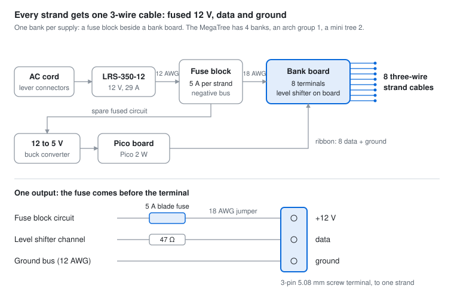
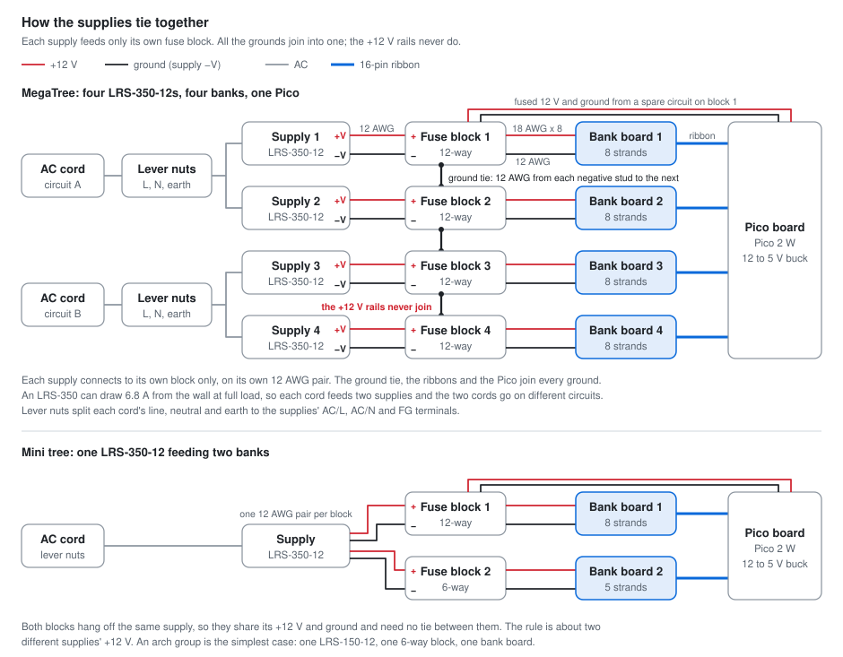

# Power and controllers

Every strand gets one 3-wire cable from one screw terminal carrying fused 12 V, data and ground,
the same output as the universal-strip-controller PCB design (with a blade fuse in place of the
PCB's polyfuse). Until the PCB is finished, the controllers are perfboard: one **bank** per power
supply, made of a fuse block mounted beside a bank board with 8 outputs and its own level shifter.

- **Bank board.** Perfboard with an SN74LVC8T245 level shifter (on a TSSOP-24 breakout), a 47 ohm
  resistor on each data line, and 8 three-pin 5.08 mm screw terminals, one per strand. It carries
  data and ground; the 12 V for each terminal comes from the fuse block beside it.
- **Fuse block beside each bank board.** A blade fuse block with a negative bus (12 circuits for
  an 8-output bank, 6 for a small one), mounted right next to the terminal row. DaierTek blocks
  have M5 studs (#10 rings) and M4 circuit screws (#8 rings); Blue Sea ST 5026 and 5025 are the
  name-brand choice. Each 5 A fuse feeds its strand's +12 V terminal through a short 18 AWG
  jumper, so the fuse comes before the terminal and protects the jumper, the terminal and the
  whole strand cable. Spare circuits feed the 12 to 5 V buck and the star topper.
- **Heavy current stays off the perfboard copper.** 12 AWG from the supply to the fuse block, and
  a 12 AWG solid ground bus along the back of the bank board tied to the block's negative bus. The
  pads only ever carry one strand's current.
- **Logic.** The Pico 2 W sits on its own small board with a 12 to 5 V buck, and reaches each
  bank board over a 16-pin ribbon that carries the 8 data lines and both of the level shifter's
  supplies (see [the ribbon](#the-ribbon-and-the-level-shifter) below).
- **One ground, separate 12 V rails.** Tie every supply's negative and the Pico's ground
  together; never join two supplies' positives.
- **Fuse size.** Size each fuse to the strand's wire, not its load: 5 A suits 18 AWG pigtails and
  leads.
- **Strand cables.** xConnect pigtails with one bare end: the bare end, with a crimped ferrule,
  goes into the screw terminal and the plug goes out through a cable gland. No soldering.
- **AC side.** Lever connectors under a cover, and the cord through a gland with strain relief.
  Check the LRS-350's 115/230 V input switch before first power-up.

## How the supplies tie together

- **Each supply feeds only its own fuse block,** on its own 12 AWG pair to the block's + stud and
  negative bus. Never join two supplies' +12 V: tied together they fight over the load, and one can
  end up carrying both.
- **Every ground joins.** The MegaTree's fuse blocks are daisy-chained with 12 AWG from one
  negative stud to the next, so the four supplies, the bank boards and the Pico share one ground
  without leaning on the ribbon's thin wires.
- **The Pico board** takes fused 12 V and ground from a spare circuit on block 1 and sends 3.3 V,
  5 V and ground to every bank board over the ribbons.
- **One supply, two blocks.** A mini tree's LRS-350 feeds both of its blocks, each on a separate
  12 AWG pair from the supply's spare terminals (it has three +V and three -V). That is one rail,
  so no tie is needed.
- **Wall power.** An LRS-350 draws up to 6.8 A from the wall at full load, so one cord feeds at most
  two of them and the tree's two cords go on different circuits. At last year's brightness they
  draw far less. Lever nuts split each cord's line, neutral and earth to the supplies' AC/L, AC/N
  and FG terminals.

## The ribbon and the level shifter

The SN74LVC8T245 needs two supplies: 3.3 V on its A side, so it reads the Pico's 3.3 V signals
correctly, and 5 V on its B side, so the pixels get a full 5 V data signal. Both draw only a few
milliamps, so the Pico board sends them down the ribbon: 3.3 V from the Pico's 3V3 pin and 5 V
from the buck. The bank board then needs nothing but 12 V for the strands.

The ribbon is 16-wire, with a 16-pin (2x8) IDC socket on each end and a shrouded 2x8 box header
on each board, so it only plugs in one way. Crimp both sockets onto the same face of the ribbon
with the socket's triangle on the red stripe, so pin 1 lands on pin 1 at both ends, and check
each new cable with a continuity tester. A clamp and two scraps of wood press a socket closed
evenly; pliers close one end first.

Every data line has a ground on the wire next to it:

| Pin | Signal | Pin | Signal |
| --- | --- | --- | --- |
| 1 | ground | 2 | data 1 |
| 3 | data 2 | 4 | ground |
| 5 | data 3 | 6 | data 4 |
| 7 | ground | 8 | data 5 |
| 9 | data 6 | 10 | ground |
| 11 | data 7 | 12 | data 8 |
| 13 | ground | 14 | 3.3 V |
| 15 | 5 V | 16 | ground |

On the 2x8 header the odd pins are one row and the even pins the other.

Level shifter pins (from TI's SN74LVC8T245 datasheet):

| Shifter pin | Connect to |
| --- | --- |
| 1, VCCA | ribbon 3.3 V |
| 2, DIR | VCCA, so data always runs A to B |
| 3-10, A1-A8 | ribbon data 1-8 |
| 11, 12, 13, GND | ground |
| 14-21, B8-B1 | through a 47 ohm resistor each to terminals 8-1 (B1 is pin 21, so the order runs backwards) |
| 22, OE | ground, so the outputs are always on |
| 23, 24, VCCB | ribbon 5 V |

Put a 0.1 uF ceramic capacitor from VCCA to ground and another from VCCB to ground, right at the
chip.

## Banks per prop

All pixels are 12 V. MegaTree sizing uses 0.54 W per node at full white, the figure the
Christmas-lighting forums use for Holiday Coro nodes; the mini trees use Wally's Lights' rating of
0.25 W for their bullet pixels. Calm effects sit far below full white: the old MegaTree
brightness of 32/255 is about 12%.

| Prop | Pixels | Full white | Supplies | Banks | Brightness cap for the supplies |
| --- | --- | --- | --- | --- | --- |
| MegaTree | 32 x 200 = 6,400 | about 3,460 W | 4 x Mean Well LRS-350-12 | 4 x 8 outputs | 40% |
| Star topper | 90 | about 50 W | shares a tree supply | a spare fuse block circuit | none |
| Arch group (each of 2) | up to about 270 | up to 150 W | 1 x LRS-150-12 (LRS-350-12 if bigger) | 1 small bank | none |
| Mini tree (each of 2) | 13 x 100 = 1,300 | about 325 W | 1 x LRS-350-12 | 8 + 5 outputs | none |

The LRS supplies aren't waterproof, so they live inside the enclosure (CableGuard CG-1500 or
similar) with cables entering from the bottom and drip loops. Lay one bank out at full size before
buying boxes; the tree may need more than two CG-1500s, or one larger box.

## Wire sizes

Keep the round-trip drop on any 12 V run under about 1 V:
drop = 2 x length in feet x amps x ohms per foot (18 AWG 0.0064, 16 AWG 0.0040, 14 AWG 0.0025,
12 AWG 0.0016).

| Run | Current | Wire | Why |
| --- | --- | --- | --- |
| Supply to fuse block, inside the box | up to 29 A (the LRS-350's limit) | 12 AWG, under 2 ft | carries the supply's full output with little heat |
| Bank board ground bus | up to 29 A | 12 AWG solid | the same current, a few inches long |
| Fuse to terminal | one strand | 18 AWG jumper | short, and the fuse protects it |
| Bank board to a strand | about 3.6 A for a MegaTree strand at 40%, 2.2 A for a mini-tree strand at full white | 18 AWG 3-wire (xConnect) | 0.5 V drop at 4 A over 10 ft |
| Long runs to the arches | about 3 A | 18 AWG to about 25 ft, 16 AWG to about 40 ft | stays near 1 V of drop |
| Power injection | only if a test shows color shift at the far end | 16 AWG pair on its own 5 A fuse | most strands at calm brightness won't need it |

## Sources

- Mean Well [LRS-350-12](https://www.bravoelectro.com/lrs-350-12.html) and
  [LRS-150-12](https://www.bravoelectro.com/lrs-150-12.html) (Bravo Electro)
- LRS-350 AC current and terminals: [Mean Well LRS-350 datasheet](https://www.meanwell.com/Upload/PDF/LRS-350/LRS-350-SPEC.PDF)
- Enclosure sizes: [Pierce Lights](https://www.piercelights.com/tech/enclosures)
- Per-node current: [auschristmaslighting.com](https://auschristmaslighting.com/threads/reference-of-current-draws-of-common-rgb-lights-used.3812/)
- Level shifter pinout: [TI SN74LVC8T245 datasheet](https://www.ti.com/lit/ds/symlink/sn74lvc8t245.pdf)
- Mini-tree pixels: [Wally's Lights 12 V WS2811 xConnect bullet pixel](https://wallyslights.com/products/12v-ws2811-xconnect-resistor-bullet-pixel?variant=39808961413278)
